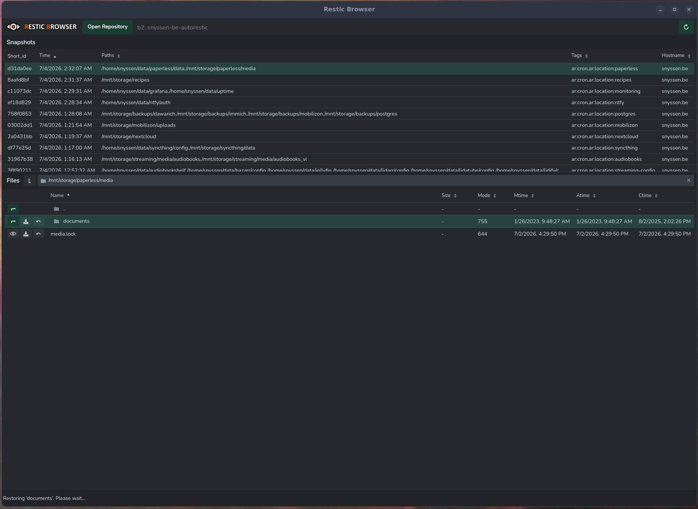

# Backups

## `apps` backups and restores (Backrest)

`apps` (the new NixOS VM, see `docs/hypervisor/apps-migration-plan.md`) runs
[Backrest](https://github.com/garethgeorge/backrest) as a native NixOS systemd
service — `nix/modules/nixos/backrest/` (reusable module: `default.nix` holds the
options, `service.nix` the service and rendered `config.json`, `restore.nix` the restore
commands, `scripts/` the shell they run) + `nix/hosts/apps/backrest.nix` (this host's
actual repo/plan config). Unlike the
legacy `container_backrest` role below, this one is fully declarative: repos and
plans are Nix options, rendered into Backrest's `config.json` via `sops.templates`
(secrets filled in from `nix/hosts/apps/data/secrets.yaml`), not configured by hand
through its UI.

Reached at `https://backrest.${domain}` behind Authelia, and also directly on port 9898
from the tailnet (`openFirewall = true`) for when the reverse proxy is down. It has its
own login on top of that, declared as `backrest.users` — Backrest refuses to run a
genuinely open UI, so the account is declarative rather than clicked in.

### Two repositories, deliberately separate

| repo | URI | role |
| --- | --- | --- |
| `backup_snyssen_be` | `rest:http://backup.snyssen.be:8000/` | The **live production** repo, registered read-only. No plans, and no prune/forget/check policy — `apps` must never be able to alter production's snapshot set. |
| `apps` | `rest:http://backup.snyssen.be:8000/apps/` | `apps`'s own backups. A separate repository on the same rest-server (it runs without `--private-repos`, so a subpath is served as its own repo), so retention and pruning here are safely scoped. |

Registering the production repo is what makes restore-testing possible at all: Backrest
indexes a repo's snapshots directly, not just the ones it created, so every snapshot
autorestic has ever written is browsable and restorable onto `apps` — retargeted to any
path — without defining anything.

An off-site copy of `apps`'s own backups (B2, as production has) is still to come. Until
then the restore commands below take `--repo-uri` for the case where the on-site server
is unreachable.

### The restore commands

All of these are generated from the Nix config and live on `apps` itself, so a VM
rebuilt from `nixosConfigurations.apps` has them without any extra setup. All run as
root.

| command | what it does |
| --- | --- |
| `backrest-restore` | Disaster recovery. Derived automatically from `backrest.plans`, so it always covers exactly what is backed up — one selectable group per plan, restoring each path to where it came from. |
| `postgres-restore` | Loads PostgreSQL dumps back with `pg_restore`, across every PostgreSQL instance on the host (see below). `backrest-restore` only puts the dump *files* back; a directory of dumps is not a database. |
| `prod-import` | Pulls legacy-production data onto `apps` with paths and ownership translated. Transitional — `nix/hosts/apps/prod-import.nix` gets deleted at the Phase B cutover. |
| `apps-restore` | Thin wrapper: `backrest-restore --all` then `postgres-restore --all`. |

Shared flags: `--list`, `--dry-run`, `--yes`, and `--at` to restore an older state. The
restic-backed ones additionally take `--check` (resolve each group's snapshot and verify
it actually contains every configured path — seconds, no writes, exits non-zero on a
problem), `--repo-uri` to read from a different copy of the repository, and
`--keep-stopped`.

`--keep-stopped` leaves the units a restore stopped stopped, rather than starting them
again at the end. Worth reaching for when you want to look at restored data *before* the
application does — many apps migrate or rewrite their state on first start, which is
hard to undo — or when running several restores back to back without the stack flapping
up and down between them. The units are stopped beforehand either way; the command ends
by naming everything it left down, alongside `backrest.service`, which is never
restarted automatically:

```text
Left stopped on purpose: backrest.service compose-monitoring.service
Verify the restore, then: systemctl start backrest.service compose-monitoring.service
```

```sh
backrest-restore --check                        # the cheap, run-it-often health check
prod-import --list
prod-import monitoring streaming-config --dry-run
prod-import monitoring                          # several groups may be named at once
backrest-restore --all --at 2026-10-01          # the state as of the 1st
postgres-restore --from /mnt/bulk/restore/prod-postgres authelia
```

Before writing anything, they resolve one snapshot per group, size every entry with a
real `--dry-run` restore, check the total against free space **per filesystem** (`/` and
`/mnt/bulk` are separate budgets, and both are tight), and print the whole plan for
confirmation. They also stop `backrest.service` and deliberately leave it stopped — see
the warning in the DR runbook below.

### More than one PostgreSQL instance

Most databases share the central cluster, but some stacks must run their own — Immich
needs the `vectorchord`/`pgvecto.rs` extensions the central Postgres 18 does not have,
and Dawarich and Mobilizon will want the same when they migrate.

That stays an implementation detail of those stacks rather than something to keep track
of: a database name selects its instance, so `postgres-restore immich` reaches the right
container on its own, and `postgres-restore --all` really does mean all. Each instance
is registered by the stack that owns it (`postgresRestore.instances.<name>`), so a stack
and its restore path are added and removed together, and a database name claimed by two
instances fails the build rather than picking one arbitrarily.

```sh
postgres-restore --instances      # which instance serves what
#   databases    audiomuse authelia lldap matrix … umami
#   immich       immich
```

With no `--from`, each database is read from its own instance's dump directory — which
is what makes a full recovery a single command. Pass `--from` when restoring out of a
staging directory instead, as after a `prod-import`:

```sh
prod-import immich
postgres-restore --from /mnt/bulk/restore/prod-immich immich
```

Since `--from` applies to everything selected, use it with databases from one instance
at a time.

The photo *files* are a separate `prod-import photos` group (~88 GB) restoring straight
to `/mnt/bulk/photos`, since those are the originals Immich serves rather than something
that needs loading afterwards. Restoring Immich's database without them leaves a library
whose every asset is missing, so do both or neither.

Paperless is split the same way, for a different reason. `paperless` is the live library
and `paperless-export` is the nightly `document_exporter` output — the same documents in
a portable form that can be read back with neither this PostgreSQL nor this Paperless
version. Both exist as plans and as `prod-import` groups, and the export roughly doubles
the bytes, so it is worth deciding deliberately rather than reaching for `--all`:
importing only `paperless` is fine, since the nightly `paperless-export.timer`
regenerates the export once the library is in place. The database itself is in the
central cluster, so it comes back with `postgres-restore paperless` like any other.

Mind the order, though: the export runs `document_exporter --delete`, so it mirrors the
library rather than accumulating — and run against a database that has not been restored
yet, it finds no documents and clears the export directory. `prod-import paperless`
restarts the stack when it finishes, so either load the database before the next 22:43 or
pass `--keep-stopped` and start the stack yourself afterwards. Neither case loses
anything permanently: the export is in its own snapshots and is regenerable from the
library.

### Restoring an older state: `--at`

`--at WHEN` restores each group's state **as of** that moment: for every group, the
newest snapshot at or before it. Anything `date(1)` understands works — `2026-10-01`,
`"2026-10-01 14:00"`, `"3 days ago"`, `yesterday`. A bare date means the *end* of that
day, because backups run in the small hours and midnight would quietly hand back the
previous day's snapshot. The resolved instant is always printed, so it is never guesswork.

The thing to understand: **groups do not all have a snapshot for every date.** Retention
thins older snapshots out, and a backup can simply have failed that night. Rather than
inventing a rule for that, the command shows it — each group prints the snapshot it
landed on and how far before your requested time it is, with a `!` on anything more than
48 hours off:

```text
Restoring each group's state as of 2026-09-15 23:59:59 +0200
Resolving snapshots...
  ! monitoring           acfcea89  2026-08-31T00:39:10  (15d23h before)
    streaming-config     1f20c7a3  2026-09-15T00:30:12  (23h0m before)
```

That first line is a real result from the production repo — mid-September is past the
daily retention window, so the nearest snapshot is two weeks older. Whether that's
acceptable is a judgement call, which is why it goes in front of you at the confirmation
prompt rather than being decided for you.

A group with **no** snapshot at or before the requested time is a hard error naming the
group and its oldest available snapshot, so you can pick a workable `--at` instead of
restoring a surprise.

`postgres-restore --at` works the same way and means the same thing, which is why
`apps-restore` forwards the flag to both halves — restoring files from one date while
loading databases from another would produce a system state that never existed. It
picks a dump by mtime across **all four backup tiers** (`last`, `daily`, `weekly`,
`monthly`) rather than only the newest daily, since the tiers have different depths.
Against the production dumps that spans half a year, and the `last/` tier gives
intra-day precision:

```text
--at "8 hours ago"   ->  last/authelia-20261017-083000.sql.gz     (1h47m before)
--at 2026-09-20      ->  weekly/authelia-202638.sql.gz               (3h before)
--at 2026-06-15      ->  monthly/authelia-202605.sql.gz           (15d3h before)
```

**Granularity varies with age**, and it is worth knowing which band you are asking in.
Dumps run every four hours (`SCHEDULE: 30 */4 * * *`) and `last/` retains about a day of
them, so within the last ~24 hours you get four-hourly precision. Beyond that only one
dump per day survives — each day's *final* run, around 20:30 — so asking for a weekday
morning three days back lands on the previous evening:

```text
--at "8 hours ago"      ->  last/…-20261017-083000   08:30 today      (1h47m before)
--at "30 hours ago"     ->  daily/authelia-20261015  10-15 20:30     (15h47m before)
--at "2026-10-15 10:00" ->  daily/authelia-20261014  10-14 20:30     (13h30m before)
```

That is correct "as of" behaviour — there simply is no dump between those two evening
runs — but the request alone doesn't suggest it, which is what the skew column is for.

A database with **no** dump at all is skipped and reported — that is what lets the
command run unchanged against a production dump directory full of databases this host
doesn't have. A database that has dumps but none at or before the requested time is a
hard error instead, for the same reason as above: restoring the rest while silently
dropping one would leave the cluster inconsistent.

The legacy production box's `autorestic` setup (below) is untouched and keeps running
until the Phase B cutover.

## Current backup system

Backups are orchestrated with **autorestic** (Restic wrapper), configured and deployed by:

- playbook: `ansible/playbooks/backup-run.ansible.yml`
- role: `ansible/roles/setup_backups`
- generated config template: `ansible/roles/setup_backups/templates/autorestic_config.yaml`

### How autorestic is configured

`setup_backups` deploys:

- `/root/.autorestic.yml` (rendered from the template above)
- `/root/scripts/autorestic_log_wrapper.sh` (splits logs per location in `/var/log/autorestic`)
- cron jobs:
  - every 30 minutes: `autorestic --ci cron --lean`
  - weekly integrity check: `autorestic --ci check` (Monday at 16:10)

The autorestic config is generated from inventory vars:

- `autorestic__backends` (backend definitions)
- `autorestic__locations` (what to back up and where)

Those vars are sourced from vault values in:
`ansible/hosts/group_vars/apps/vars.yml`.

### Retention and hooks

Each location currently uses:

- keep daily: 14
- keep weekly: 4
- keep monthly: 6
- keep yearly: 1

The template also wires hooks for:

- per-location pre-backup commands
- optional backend before/after commands
- uptime kuma success/failure push monitoring

### Backup destinations

Destinations are the autorestic **backends** declared in `autorestic__backends` (vault-managed).

From the current backup playbook examples, commonly used backend names are:

- `backup-snyssen-be`
- `snyssen-be-autorestic`

Exact credentials and backend env vars are intentionally vault-managed and not documented in plain text in this repository.

## Restore workflows

### 1) Restore backup files from autorestic

Use this first when local files/dumps are missing:

```sh
ansible-playbook playbooks/backup-restore.ansible.yml -e '{"backup_backend":"backup-snyssen-be","backup_location":"postgres","backup_snapshot":"<snapshot-id>","backup_restore_directory":"/mnt/tmp"}'
```

Notes:

- `backup_location` is an autorestic location (for example `postgres`, `nextcloud`, ...).
- If `backup_snapshot` is omitted, latest snapshot is restored.
- If `backup_restore_directory` is omitted, restore is done with `/` as root.

### 2) Restore PostgreSQL databases from local dumps

Use the DR-oriented playbook:

```sh
ansible-playbook playbooks/backup-restore-databases.ansible.yml
```

Behavior:

- restores postgres-related databases from local dump files
- auto-selects latest dump per database (non-interactive)
- fails early with guidance if a local dump is missing

Scope control:

```sh
ansible-playbook playbooks/backup-restore-databases.ansible.yml -e '{"db_restore_include":["nextcloud"]}'
ansible-playbook playbooks/backup-restore-databases.ansible.yml -e '{"db_restore_exclude":["recipes"]}'
```

### 3) Suggested disaster-recovery sequence (high level)

1. Re-provision host/services baseline (Nix/Ansible deployment flow).
2. Restore backup files with `backup-restore.ansible.yml` for required locations.
3. Run `backup-restore-databases.ansible.yml` to restore all PostgreSQL-related DBs.
4. Start/restart application stacks and verify service health.
5. Run backup listing/integrity checks to validate backup system availability.

## B2 setup

The setup for the Backblaze B2 backups are based on [this write-up](https://scribe.rip/@benjamin.ritter/how-to-do-ransomware-resistant-backups-properly-with-restic-and-backblaze-b2-e649e676b7fa) (I recommend skipping to the TL;DR).

### Bucket creation

1. [Install the Backblaze CLI tools](https://www.backblaze.com/docs/cloud-storage-command-line-tools)
2. Create an [application key](https://secure.backblaze.com/app_keys.htm) with permissions to create buckets and other keys (I recommend creating temporary keys for this by setting a short expiration time) and authenticate with it

```sh
b2 account authorize [applicationKeyId] [applicationKey]
```

3. Create a new bucket with lifecycle rules:

```sh
b2 bucket create --default-server-side-encryption SSE-B2 --lifecycle-rule '{"daysFromHidingToDeleting": 30, "daysFromUploadingToHiding": null, "fileNamePrefix": ""}' [bucket-name] allPrivate
```

4. Create an application key with limited access to your specific bucket (I like to use the same key name as the bucket name):

```sh
b2 key create --bucket [bucket-name] [key-name] listBuckets,listFiles,readFiles,writeFiles
```

5. Take note of the key ID and its value that are outputted after running the previous command, you will need them to configure autorestic

In case of ransomware, lost data on the bucket can be restored using [this software](https://github.com/viltgroup/bucket-restore).

## Disaster Recovery

For individual files — and for anything exploratory — use **Backrest's own web UI**:
browse any repo's snapshots and restore files or whole snapshots to any target path.
It's just restic underneath, so this is a convenience layer, not a dependency.

### Rebuilding `apps` from scratch

> [!WARNING]
> Boot the rebuilt host with `docker.service` and `backrest.service` **masked**, before
> restoring anything. Otherwise every stack starts against empty data directories: Traefik
> requests a fresh certificate for ~30 hostnames (Let's Encrypt's weekly limits turn a
> second failed attempt into days without TLS), and — worse — Backrest's schedules fire and
> back up the *empty* state over the good snapshots, after which retention starts forgetting
> the originals. A DR rehearsal would then have destroyed the real backups.

0. **Prerequisites that are in no backup**: this git repository, an age identity that can
   decrypt `nix/hosts/apps/data/secrets.yaml`, and the hypervisor with `/mnt/bulk/apps`
   intact. See the key-management warning below — this step is the real single point of
   failure, not the data.
1. `just hypervisor-build-vm-images` — note this generates a **new** SSH host key, and
   therefore a new `root_apps` age key.
2. Add that key to `.sops.yaml` and run
   `just sops-update-keys file=nix/hosts/apps/data/secrets.yaml`, then commit. **Not
   optional**: without it sops-nix fails to decrypt and the restic repository password
   never appears on the host, so nothing can be restored.
3. `just hypervisor-provision-vms`.
4. At the GRUB prompt press `e` and append to the kernel command line:

   ```text
   systemd.mask=docker.service systemd.mask=backrest.service
   ```

   Every `compose-*` unit has `requires=docker.service`, so this masks all of them, plus
   cAdvisor, in one go. They land in `failed` with "Unit docker.service is masked" —
   harmless; `systemctl reset-failed` afterwards.
5. Sanity-check: `ls /run/secrets/backrest/repos/`, `tailscale status`, and `ls /mnt/bulk`
   (which triggers the automount).
6. Make sure the backup server is awake — it is wake-on-LAN'd and may be powered down.
   Poll `http://backup.snyssen.be:8000/metrics` for a 200; allow up to ~5 minutes. **Keep
   its IP and MAC address somewhere outside this repo**: in a real disaster, DNS for
   `backup.snyssen.be` may be gone along with the production box. Alternatively point
   `--repo-uri` at the off-site copy.
7. **In tmux** — a few hundred GB over NFS-over-Tailscale takes hours and an SSH drop
   would kill the run:

   ```sh
   backrest-restore --all --dry-run    # review the per-filesystem size table
   backrest-restore --all
   ```

8. `systemctl unmask docker.service backrest.service && reboot`. Everything then comes up
   in dependency order, and `compose-databases` provisions roles and databases via its
   `ExecStartPost`.
9. `postgres-restore --all` to load the dumps that step 7 restored.
10. Smoke-test the services, then `systemctl start backrest.service`.

Steps 7 and 9 together are what `apps-restore` does.

### Testing it without a full rebuild

`backrest-restore --check` resolves every plan's latest snapshot and verifies it actually
contains each configured path. It takes seconds, writes nothing, and exits non-zero on a
problem — it is the check worth running regularly. A full rebuild is the fidelity test;
the Phase B cutover is itself that rehearsal.

### If Backrest (or `apps` itself) is unavailable

Any restic repository is directly usable with the plain `restic` CLI — no Backrest
required. Pull the repo's `uri` and password straight from wherever they're
declared (today: ansible-vault for autorestic's repos; for `apps`'s Backrest-managed
repos, the sops-decrypted `nix/hosts/apps/data/secrets.yaml`), then:

```sh
export RESTIC_REPOSITORY="rest:http://backup.snyssen.be:8000/"   # on-site REST server
# export RESTIC_REPOSITORY="b2:snyssen-be-autorestic"            # off-site; also needs
# export B2_ACCOUNT_ID=... B2_ACCOUNT_KEY=...
export RESTIC_PASSWORD="..."
restic snapshots
restic restore <snapshot-id> --target /path/to/restore
```

To restore a subtree somewhere other than its original path — what `prod-import`
automates — use restic's `snapshotID:subfolder` syntax, which makes the subfolder the
root of the restore:

> [!NOTE]
> **Restoring onto `/mnt/bulk` by hand? Add `--exclude-xattr system.nfs4_acl`.**
> That mount is NFSv4, whose client exposes a synthetic `system.nfs4_acl` attribute on
> every file. Snapshots from ordinary filesystems don't carry one, so restic tries to
> remove it and NFS refuses (`setfattr -x` fails the same way — it's derived from the
> mode bits, not stored). Contents restore perfectly, but restic counts one error per
> file and exits non-zero, so a clean restore looks like a failure. The generated
> commands already pass this flag; raw `restic` invocations need it themselves.

```sh
restic restore 'latest:/mnt/storage/nextcloud' --target /mnt/bulk/nextcloud \
  --tag ar:location:nextcloud --host snyssen.be
```

### Key management: the actual single point of failure

> [!CAUTION]
> `nix/hosts/apps/data/secrets.yaml` can only be decrypted by the age keys listed in
> `.sops.yaml` — in practice the SSH host keys of a couple of workstations. The restic
> repository passwords live *inside* that file. If those machines are lost together with
> everything else, the backups are intact and unreadable.
>
> This cannot be fixed with a backup plan (backing up the key into a repository whose
> password the key protects is circular). It is a process fix:
>
> - Generate a **breakglass SSH keypair**, add its age recipient (`ssh-to-age`, already in
>   the devshell) to every creation rule in `.sops.yaml`, re-run `just sops-update-keys`
>   for each secrets file, and keep the private key **only** in a password manager.
> - Keep the restic repository passwords in that password manager too. Recovering them
>   through sops requires a git checkout and a working age key; having them directly to
>   hand is what makes the "nothing but the raw credentials" path below actually work.

Other things no backup covers, worth knowing before relying on one: Docker images are
pinned by digest, so a recovery with no internet access (or after an upstream digest is
garbage-collected) leaves stacks that will not start; and Docker **named** volumes are not
backed up by anything here. Today every named volume in use is disposable (Redis caches,
scratch audio) — the convention for new stacks is that anything stateful is a bind mount
under `/var/lib/app-data` or `/mnt/bulk`, never a named volume.

### If the house burns down — no access to this repo, no Nix, nothing but the raw credentials

There could be a situation where the entire infrastructure is lost, and rebuilding is not an option (lack of time, hardware, energy, money, etc.). In such case, we would have to do without any of the services provided by this infra, but should still be able to access raw files such as important documents.

For such [Restic Browser](https://github.com/emuell/restic-browser) should be our go to solution. The preferred way of using it is on a NixOS machine, which can use the `restic-dr` home-manager module provided in this repository to install both Restic and Restic Browser. Otherwise, Restic Browser being cross-platform, it should be installable on pretty much any machine, and could thus be used anywhere to connect to our Restic repositories.

Repository URIs and passwords live in two places today, and this scenario assumes you can reach neither: the legacy autorestic repos in the ansible-vault managed `ansible/hosts/group_vars/apps/vault.yml`, and `apps`'s own in the sops-managed `nix/hosts/apps/data/secrets.yaml`. **That is exactly why the credentials also belong in a password manager** — see the key-management warning above. Once connected to the repository, select the desired snapshot and you should be able to browse and download files and directories directly.

> [!IMPORTANT]
> Browsing and especially downloading files can be really slow, especially on remote repositories and using a slow Internet connection. Aggravating the issue, Restic Browser is not always explicit about running operations, as it only shows a small, easy to miss, status message at the bottom of the window (see screenshot), and not blocking the UI while the operation is running. **Please be patient!**
> 

One of the most important backup for such a DR scenario is the paperless backup, which contains important administrative documents. The good news is that there is a special Restic target dedicated for this scenario: *paperless-export*. This target contains a full daily export of all paperless documents, thanks to the [document exporter](https://docs.paperless-ngx.com/administration/?__cf_chl_f_tk=p0Z.dngVSr7o5h8HL9aoSHhqRB3XcYjTxu15mv1naoc-1783169274-1.0.1.1-Gnmm4sduO5d1suEgqYOoneXWqAfuDpARUvYWiZ1FO3U#exporter) feature of Paperless-ngx. This means that all documents are available in a browseable flat file format, directly restorable from the snapshots of this target.
