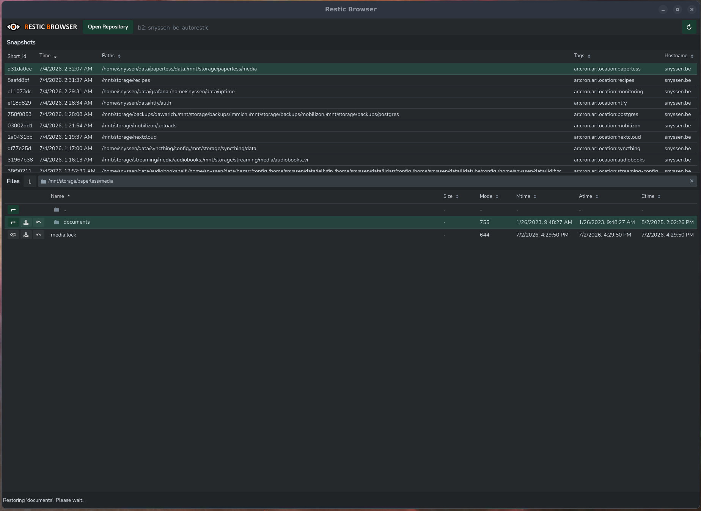

# Backups

Production's apps run on `apps-01`, a NixOS VM, and are backed up by
[Backrest](https://github.com/garethgeorge/backrest), a restic wrapper with a web UI,
configured entirely in Nix (`nix/modules/nixos/backrest/` +
`nix/hosts/apps-01/backrest.nix`). Restores go through commands generated from that same
config and installed on the host.

It is restic underneath, so every repository is also readable with the plain `restic` CLI
or with Restic Browser, with no Backrest involved. That is what
[Last-resort access](#last-resort-access) relies on.

> [!NOTE]
> The two repositories are the ones autorestic wrote to on the old bare-metal box,
> `snyssen.be`, until the cutover to `apps-01` on 2026-11-23. Its snapshots (tagged
> `ar:location:<name>`, host `snyssen.be`) sit alongside Backrest's and are browsed and
> restored the same way. That box and its Ansible backup tooling no longer exist; the
> migration itself is recorded in [the archive](../archive/apps-migration-phase-b.md).

The workstation, blackfog, has a second and much smaller setup of its own, for work in
progress: see [Workstation backups](#workstation-backups-blackfog).

---

## Backrest on `apps-01`

Backrest runs as a native NixOS systemd service, not a container: it needs broad read
access across every stack's data regardless of which uid owns it. It is fully
declarative — repositories and plans are Nix options rendered into Backrest's
`config.json` through `sops.templates`, never clicked together in its UI.

The module is split: `default.nix` holds the options, `service.nix` the service and
rendered config, `restore.nix` the restore commands, `forget.nix` the bulk-forget
commands, `scripts/` the shell they run, and `paths.nix` the couple of on-disk paths
(Backrest's data directory and `config.json`) the service and the commands must agree on.
`nix/hosts/apps-01/backrest.nix` is this host's actual repository and plan configuration.

Reached at `https://backrest.${domain}` behind Authelia, and also directly on port 9898
from the tailnet (`openFirewall = true`) for when the reverse proxy is down. It has its
own login on top of that, declared as `backrest.users` — Backrest refuses to run a
genuinely open UI, so the account is declarative rather than clicked in.

### Two repositories: production's own

| repo | URI | role |
| --- | --- | --- |
| `backup_snyssen_be` | `rest:http://backup.snyssen.be:8000/` | On-site, the dedicated restic REST server. Every plan writes here; `backrest-restore` reads it. |
| `snyssen_be_autorestic` | `b2:snyssen-be-autorestic` | Off-site. Every plan except the on-site-only ones writes here too, as `<plan>-offsite`; `backrest-restore-offsite` reads it. |

The names are historical: these are the repositories autorestic wrote to before the
cutover, continued rather than replaced, so the whole history stays in one place and
Backrest's UI browses the pre-cutover snapshots as easily as its own.

**Retention never touches the pre-cutover snapshots.** A plan's retention only forgets
snapshots tagged with that plan *and* `created-by:apps-01`, which autorestic's
(`ar:location:*`) are not, so that history stays until it is removed by hand with
[`backrest-forget`](#forgetting-old-snapshots-by-hand). A repo-level `forgetPolicy`
would forget every snapshot in the repo, grouped by tags, so neither repo has one, and
neither should ever get one.

**The B2 key cannot delete.** It was created without `deleteFiles` (see
[the appendix](#appendix-b2-bucket-setup)), so restic *hides* what it removes, and the
bucket's lifecycle rule deletes hidden files 30 days later. An attacker holding the key
gets 30 days of grace, and space freed by a prune on B2 only comes back 30 days later.

### What gets backed up

Plan boundaries mirror roughly one per stack, which is also the unit a restore is
selected by. Every plan runs daily at 00:30 into the on-site repository, and its
`<plan>-offsite` twin at 03:30 into B2, so a night's on-site backups get the disks
first. A Backrest plan targets a single repository, hence two plans per location rather
than one plan and a copy. Every plan keeps the same depth (daily 14 / weekly 4 /
monthly 6 / yearly 1). See `nix/hosts/apps-01/backrest.nix` for the current list.

On-site only, for their size: `movies` and `tv` (~10 TB), `media-extra` (podcasts,
books) and `peertube-data`.

The repositories' own jobs:

| | on-site | off-site (B2) |
| --- | --- | --- |
| check | weekly, Monday 04:00, reading 10% of the data (all of it in ~10 weeks) | monthly, the 1st at 05:00, reading 2% (B2 bills downloads beyond 3× the stored volume) |
| prune | weekly, Sunday 04:00, if over 10% of the repo is unused | monthly, the 15th at 05:00, same threshold |

Every plan reports each run to its own Gatus push endpoint, `backups_<plan>`: success
(or nothing new to back up) as up, failure or warnings as down. A plan with no report
for 26 hours is marked down too, which is what catches a backup that never ran. Gatus
only checks once per interval, so that can take up to twice as long to show. Grafana
alerts on it, like on every other Gatus check. The checks and prunes report the same
way, to `backups_check-onsite`, `backups_prune-onsite`, `backups_check-offsite` and
`backups_prune-offsite`, each allowed a day past its schedule.

Three things are deliberately *not* backed up, and the reasoning is worth knowing
before assuming a gap:

- **Live PostgreSQL data directories.** Only the dumps under `/mnt/bulk/backups/` are
  backed up. A running cluster's files are not consistently snapshottable.
- **Prometheus and Loki TSDBs, and Gatus's check history.** Observability history,
  continuously regenerated, not configuration. Gatus's checks themselves are its config,
  in the repository.
- **`ntfy`'s auth database.** Every user, ACL and token is provisioned declaratively
  from sops, so it is rebuilt from the repository on any host rebuild.

### The restore commands

Generated from the Nix config and living on `apps-01` itself, so a VM rebuilt from
`nixosConfigurations.apps-01` has them with no extra setup. All run as root.

| command | what it does |
| --- | --- |
| `backrest-restore` | Restores files. Derived automatically from `backrest.plans`, so it always covers exactly what is backed up — one selectable group per plan, each path going back where it came from. Reads the on-site repository. |
| `backrest-restore-offsite` | The same, from the `-offsite` plans in B2, under the same group names, for when the backup server is gone. On-site-only plans are not in it. |
| `postgres-restore` | Loads PostgreSQL dumps back with `pg_restore`, across every PostgreSQL instance on the host. `backrest-restore` only puts the dump *files* back; a directory of dumps is not a database. |
| `apps-restore` | Thin wrapper: `backrest-restore --all` then `postgres-restore --all`. |

Shared flags: `--list`, `--dry-run`, `--yes`, and `--at` to restore an older state. The
restic-backed ones additionally take `--check`, `--repo-uri` to read from a different
copy of the repository, `--keep-stopped`, and `--force` to carry on when the capacity
preflight says the restore will not fit.

Before writing anything, they resolve one snapshot per group, size every entry with a
real `--dry-run` restore, check the total against free space **per filesystem** (`/` and
`/mnt/bulk` are separate budgets, and both are tight), and print the whole plan for
confirmation. They also stop `backrest.service` and deliberately leave it stopped — see
the warning in the DR runbook below.

`--keep-stopped` leaves the units a restore stopped stopped, rather than starting them
again at the end. Worth reaching for when you want to look at restored data *before* the
application does — many apps migrate or rewrite their state on first start, which is
hard to undo — or when running several restores back to back without the stack flapping
up and down between them. The command ends by naming everything it left down, alongside
`backrest.service`, which is never restarted automatically:

```text
Left stopped on purpose: backrest.service compose-monitoring.service
Verify the restore, then: systemctl start backrest.service compose-monitoring.service
```

### Everyday restores on `apps-01`

Most restores are not disasters. In rough order of how often they come up:

**A few files, or anything exploratory** — use **Backrest's web UI**. Browse any
repository's snapshots and restore files or whole directories to any target path. It is
just restic underneath, so this is a convenience layer, not a dependency.

**One database:**

```sh
postgres-restore authelia                 # latest dump, from its own instance
postgres-restore authelia --at yesterday  # an older dump
postgres-restore --dry-run --all          # what would happen, writing nothing
```

**One stack's files** — name its plan. Groups are variadic, so several can go in one
run with a single preflight and a single confirmation:

```sh
backrest-restore --list
backrest-restore monitoring --dry-run
backrest-restore monitoring crowdsec
```

**Both halves of one stack** — for anything whose database and files are a matched pair
(see [below](#files-and-databases-that-must-be-restored-together)):

```sh
backrest-restore paperless --keep-stopped
postgres-restore paperless
systemctl start compose-paperless
```

**From a different dump directory** — `postgres-restore --from <dir>` reads dumps from
somewhere other than the instance's own directory. `--from` applies to everything
selected, so use it with databases from one instance at a time.

### More than one PostgreSQL instance

Most databases share the central cluster, but some stacks must run their own — Immich
needs the `vectorchord`/`pgvecto.rs` extensions the central Postgres 18 does not have,
and Dawarich needs PostGIS. Each has its own dump directory and its own plan (`immich`,
`dawarich`).

That stays an implementation detail of those stacks rather than something to keep track
of: a database name selects its instance, so `postgres-restore immich` reaches the right
container on its own, and `postgres-restore --all` really does mean all. Each instance
is registered by the stack that owns it (`postgresRestore.instances.<name>`), so a stack
and its restore path are added and removed together, and a database name claimed by two
instances fails the build rather than picking one arbitrarily.

```sh
postgres-restore --instances      # which instance serves what
#   databases    audiomuse authelia lldap matrix … umami
#   dawarich     dawarich
#   immich       immich
```

A database with **no** dump at all is skipped and reported rather than failing the
batch — which is what lets the command run unchanged against a dump directory holding
databases this host does not have.

### Files and databases that must be restored together

Some stacks keep their state in two places at once, and restoring one half produces
something that starts cleanly and is quietly broken. These are the ones to know:

| stack | the pairing | what half a restore looks like |
| --- | --- | --- |
| Immich | `immich` dumps + the `photos` plan | Library loads, every asset missing. |
| Nextcloud | `nextcloud` database + `/mnt/bulk/nextcloud` | Its database *indexes* the file tree. Started against an empty tree it runs its first-run installer and writes a config and schema of its own, which a later database restore then half-replaces. The stack ships with `autostart = false` because of this. |
| Paperless | `paperless` database + `paperless` library | Documents listed, files absent. |

Paperless additionally has a second, independent plan: `paperless-export`, the nightly
`document_exporter` output. It is the same documents in a portable form that can be read
back with neither this PostgreSQL nor this Paperless version — which makes it the most
valuable thing in the whole backup set for the
[worst-case scenario](#if-the-house-burns-down).

> [!WARNING]
> The export runs `document_exporter --delete`, so it mirrors the library rather than
> accumulating. Run against a database that has not been restored yet, it finds no
> documents and **clears the export directory**. After restoring Paperless, load its
> database before the next run at 22:43, or use `--keep-stopped` and start the stack
> yourself. Nothing is lost permanently — the export has its own snapshots and is
> regenerable from the library — but it is a confusing thing to discover.

### Restoring an older state: `--at`

`--at WHEN` restores each group's state **as of** that moment: for every group, the
newest snapshot at or before it. Anything `date(1)` understands works — `2026-10-01`,
`"2026-10-01 14:00"`, `"3 days ago"`, `yesterday`. A bare date means the *end* of that
day, because backups run in the small hours and midnight would quietly hand back the
previous day's snapshot. The resolved instant is always printed, so it is never guesswork.

The thing to understand: **groups do not all have a snapshot for every date.** Retention
thins older snapshots out, and a backup can simply have failed that night. Rather than
inventing a rule for that, the command shows it — each group prints the snapshot it
landed on and how far before your requested time it is, with a `!` on anything more than
48 hours off:

```text
Restoring each group's state as of 2026-09-15 23:59:59 +0200
Resolving snapshots...
  ! monitoring           acfcea89  2026-08-31T00:39:10  (15d23h before)
    streaming-config     1f20c7a3  2026-09-15T00:30:12  (23h0m before)
```

That first line is a real result from the production repository — mid-September is past
the daily retention window, so the nearest snapshot is two weeks older. Whether that is
acceptable is a judgement call, which is why it goes in front of you at the confirmation
prompt rather than being decided for you.

A group with **no** snapshot at or before the requested time is a hard error naming the
group and its oldest available snapshot, so you can pick a workable `--at` instead of
restoring a surprise.

`postgres-restore --at` works the same way and means the same thing, which is why
`apps-restore` forwards the flag to both halves — restoring files from one date while
loading databases from another would produce a system state that never existed. It
picks a dump by mtime across **all four backup tiers** (`last`, `daily`, `weekly`,
`monthly`) rather than only the newest daily, since the tiers have different depths.
Against the production dumps that spans half a year, and the `last/` tier gives
intra-day precision:

```text
--at "8 hours ago"   ->  last/authelia-20261017-083000.sql.gz     (1h47m before)
--at 2026-09-20      ->  weekly/authelia-202638.sql.gz               (3h before)
--at 2026-06-15      ->  monthly/authelia-202605.sql.gz           (15d3h before)
```

**Granularity varies with age**, and it is worth knowing which band you are asking in.
Dumps run every four hours (`SCHEDULE: 30 */4 * * *`) and `last/` retains about a day of
them, so within the last ~24 hours you get four-hourly precision. Beyond that only one
dump per day survives — each day's *final* run, around 20:30 — so asking for a weekday
morning three days back lands on the previous evening:

```text
--at "8 hours ago"      ->  last/…-20261017-083000   08:30 today      (1h47m before)
--at "30 hours ago"     ->  daily/authelia-20261015  10-15 20:30     (15h47m before)
--at "2026-10-15 10:00" ->  daily/authelia-20261014  10-14 20:30     (13h30m before)
```

That is correct "as of" behaviour — there simply is no dump between those two evening
runs — but the request alone does not suggest it, which is what the skew column is for.

A database that has dumps but none at or before the requested time is a hard error,
for the same reason as above: restoring the rest while silently dropping one would
leave the cluster inconsistent.

### Verifying the backups work, without a full rebuild

```sh
backrest-restore --check
```

Resolves every plan's latest snapshot and verifies it actually contains each configured
path. Seconds, writes nothing, exits non-zero on a problem. This is the check worth
running regularly — an untested backup is not a backup. Only a full rebuild (below)
tests fidelity end to end.

### Forgetting old snapshots by hand

Backrest's UI forgets one snapshot at a time, and plan retention never reaches
snapshots another tool made. For clearing out history in bulk, the pre-cutover
autorestic snapshots in particular:

| command | repositories |
| --- | --- |
| `backrest-forget` | the ones the primary plans write to (on-site) |
| `backrest-forget-offsite` | the ones the `-offsite` mirrors write to (B2) |

```sh
backrest-forget --before 2026-07-01 --dry-run     # list what would go
backrest-forget --before 2026-07-01               # same list, then confirm
backrest-forget-offsite --before "6 months ago" --tag ar:location:nextcloud
```

`--before` takes anything `date(1)` understands. A bare date means the *start* of that
day, the opposite of `--at`, so `--before 2026-07-01` keeps everything from the 1st on.
`--tag` and `--host` narrow the selection and go to restic unchanged: repeat `--tag` to
OR tags, comma-join them to AND.

**Everything before the cutoff goes**, including the final snapshot of a series that
has stopped, such as an autorestic location or a removed plan. To keep one, move the
cutoff earlier, or narrow the run with `--tag`, and check the list with `--dry-run`
first.

Forgetting frees no space. The repository's scheduled prune reclaims it (see the table
above), or start one from the repository's page in Backrest. On B2 the freed data is
then hidden for 30 days before it is deleted.

### Full disaster recovery: rebuilding `apps-01` from scratch

> [!WARNING]
> A rebuilt host must boot with its services **held** (`restoreHold` in
> `nix/hosts/apps-01/configuration.nix`, see `nix/hosts/apps-01/restore-hold.nix`).
> Otherwise every stack starts against empty data directories: Traefik requests a fresh
> certificate for ~30 hostnames (Let's Encrypt's weekly limits turn a second failed
> attempt into days without TLS), apps initialise empty instances that the restore then
> half-replaces, and — worse — Backrest's schedules fire and back up the *empty* state
> over the good snapshots, after which retention starts forgetting the originals. A DR
> rehearsal would then have destroyed the real backups.
>
> The hold replaces masking `docker.service` and `backrest.service` at the GRUB prompt,
> which needed a console in time to catch the boot.

0. **Prerequisites that are in no backup**: this git repository, an age identity that can
   decrypt `nix/hosts/apps-01/data/*.yaml`, and the hypervisor with `/mnt/bulk/apps`
   intact. See the [key-management warning](#key-management-the-actual-single-point-of-failure)
   — this step is the real single point of failure, not the data.
1. Hold the services: in `nix/hosts/apps-01/configuration.nix`, set both
   `restoreHold.stacks` and `restoreHold.backups` to `true`, and commit. The image is
   built from the committed configuration, so the very first boot is held.
2. Set `disk_image.build: true` on `apps-01` in
   `ansible/hosts/host_vars/hypervisor-01/vars.yml` (it is `false` in normal operation,
   so routine image builds leave the deployed VM alone), then
   `just hypervisor-build-vm-images hypervisor-01`. This generates a **new** SSH
   host key, and therefore a new `root_apps_01` age key.

   If the old VM, its disk or its LUKS key still exist on the hypervisor (anything short
   of losing the whole vmstore pool), stop the VM first
   (`just hypervisor-vm-destroy apps-01`) and add `-e libvirt_image_build_force=true`.
   Without it, the build refuses while apps-01 is defined, and once undefined its copy
   step silently keeps the existing image and key, so the "rebuilt" VM boots the old
   disk with the old host key.
3. Add that key to `.sops.yaml` in place of the old one and run
   `just sops-update-keys-all`, then commit. **Not optional**: without it sops-nix fails
   to decrypt and the restic repository password never appears on the host, so nothing
   can be restored.
4. `just hypervisor-provision-vms hypervisor-01`. Then set `disk_image.build: false`
   back and commit: left `true`, the next image build would overwrite the VM's disk.
5. Sanity-check, on the VM: `ls /run/secrets/backrest/repos/`, `tailscale status`,
   `ls /mnt/bulk` (which triggers the automount), and `systemctl list-units 'compose-*'`
   (nothing running).
6. Make sure the backup server answers: `curl -fsS http://backup.snyssen.be:8000/metrics`.
   **Keep its IP address somewhere outside this repo**: in a real disaster, DNS for
   `backup.snyssen.be` may be gone too. If the backup server itself is gone, use
   `backrest-restore-offsite` instead of `backrest-restore` in step 7: the same groups,
   from B2, minus the on-site-only media.
7. **In `screen`**: a few hundred GB over NFS-over-Tailscale takes hours, and an SSH
   drop would kill the run. `Ctrl-a d` detaches, `screen -r restore` re-attaches.

   ```sh
   screen -S restore
   backrest-restore --all --dry-run    # review the per-filesystem size table
   backrest-restore --all
   ```

8. Load the databases. The central cluster lives in the `databases` stack, which a held
   host leaves stopped, so start it by hand first (it provisions roles and databases on
   start, and creates the Docker networks the others use). Immich's and Dawarich's own
   PostgreSQL need no starting: `postgres-restore` reaches them through their dump
   sidecar, which starts only the database container. That container stays up
   afterwards, so stop all three stacks again and let step 9 start everything in order:

   ```sh
   systemctl start compose-databases
   postgres-restore --all
   compose-immich down
   compose-dawarich down
   systemctl stop compose-databases
   ```

9. Release the stacks: set `restoreHold.stacks = false`, commit, then
   `just nix-remote-install boot apps-01` and reboot, so everything starts in dependency
   order. Smoke-test the services.
10. Release the backups: set `restoreHold.backups = false`, commit,
    `just nix-remote-install switch apps-01`, and watch the first backup run.

Steps 7 and 8 together are what `apps-restore` does, minus the `compose-*` lines: it
neither starts nor stops any stack for you.

---

## Workstation backups (blackfog)

Separate from the apps backups above, and much lighter. They exist to get back up to
speed after a hardware failure, not to archive anything. Git protects committed and
pushed work. These cover what it doesn't: uncommitted and unpushed changes, local
branches and stashes, and gitignored files that are tedious to recreate (`.envrc`,
`.env`, credentials).

Configured in `nix/hosts/blackfog/backup.nix` with NixOS's own `services.restic.backups`,
not Backrest. There's no daemon or web UI to keep running on a workstation, and a
systemd timer catches up on runs missed while the machine was off.

### What is backed up

| | |
| --- | --- |
| paths | `~/source/repos` (whole trees, `.git` included), `~/Documents`, `~/Pictures`, `~/Music`, `~/Videos`, `~/.ssh` |
| excluded | `~/.ssh/id_*` (the keys never leave the machine; recovery goes through the breakglass key), Syncthing's state directory (`~/Documents/.config/syncthing`: identity from sops, config from Nix, index rebuilt by rescanning, and its live database must never be restored over a running Syncthing), build output (`bin`, `obj`, `node_modules`, `target`, `.direnv`, `result`, `.terraform`, `.venv`, `__pycache__`), cache-tagged directories, and any file over 1 GB (database dumps, mostly) |
| schedule | hourly, with no new snapshot when nothing changed; at boot if a run was missed |
| retention | 48 hourly, 7 daily, 4 weekly: about a month |
| maintenance | daily `forget --prune`, plus a `check` reading a different 5% of the data each day |
| repository | `rest:http://backup.snyssen.be:8000/blackfog/`, on-site only, its own password |
| password | sops (`restic/blackfog/password` in `nix/hosts/blackfog/data/secrets.yaml`, readable with the breakglass key) and the password manager |

Both jobs run as `snyssen`, who owns every file involved, so no root is needed.

### Restoring

`blackfog-restore` restores the latest snapshot in place. It overwrites files whose content
differs, even when the local copy is newer: after a fresh `git clone`, the checked-out
files are newer than the backed-up work in progress, and that work is the point. Files
created since the backup are left alone, and nothing is deleted. It always shows what
would change and asks before writing.

```bash
blackfog-restore --dry-run                          # what a full restore would change
blackfog-restore ~/source/repos/foo/.envrc          # one file (relative paths work too)
blackfog-restore --target /tmp/r ~/source/repos/foo # into a staging dir, to compare by hand
blackfog-restore --snapshot 1a2b3c4d                # an older snapshot (see below)
```

For anything else, `restic-blackfog` is restic with the repository and password already
set: `restic-blackfog snapshots`, `restic-blackfog ls latest`, `restic-blackfog mount`, and
so on.

After losing the machine: rebuild blackfog from the flake. Its sops secrets decrypt with
the breakglass key, or from purplehaze. Then run `blackfog-restore`. Without the flake
at hand, restic-browser (home module `restic-dr`) opens the repository on its own, with
the password from the password manager. It is deliberately not wired to anything else.

### Monitoring

Both jobs push their result to Gatus, in the `workstations` group (`blackfog` and
`blackfog-maintenance`), with a token of their own rather than apps-01's. Those endpoints
don't go through `EndpointDown`. Instead, `WorkstationBackupStale` fires:

- **only while blackfog is up.** Its metrics come through Alloy, so its `up` series is
  absent while it is off, and nights, weekends and holidays with the machine off never
  alert, with no silence to set.
- **after an hour.** That leaves the catch-up run at boot time to report in first.
- **muted outside working hours.** Alertmanager's `off-hours` interval covers 18:00 to
  08:00 and weekends, Belgian time. Muted, not dropped: a failure still firing at the end
  of the window is notified then.

---

## Last-resort access

Everything below works on any snapshot in either repository, Backrest's and the
pre-cutover autorestic ones alike: they are all plain restic.

### Using the repositories with plain `restic`

Any restic repository is directly usable with the plain `restic` CLI — no Backrest, no
Nix. The URIs are in [the table above](#two-repositories-productions-own); the passwords
(and the B2 key) are in the password manager, and in the sops-encrypted
`nix/hosts/apps-01/data/common.yaml` under `backrest/repos/<repo>/`. Then:

```sh
export RESTIC_REPOSITORY="rest:http://backup.snyssen.be:8000/"   # on-site REST server
# export RESTIC_REPOSITORY="b2:snyssen-be-autorestic"            # off-site; also needs
# export B2_ACCOUNT_ID=... B2_ACCOUNT_KEY=...
export RESTIC_PASSWORD="..."
restic snapshots
restic restore <snapshot-id> --target /path/to/restore
```

To restore a subtree somewhere other than its original path, use restic's
`snapshotID:subfolder` syntax, which makes the subfolder the root of the restore. The
subfolder may be *deeper* than the snapshot's own root. For a snapshot taken before the
cutover, select it by autorestic's tag and the old host name; note the old box's paths
(`/mnt/storage/...`), not apps-01's:

```sh
restic restore 'latest:/mnt/storage/nextcloud' --target /mnt/bulk/nextcloud \
  --tag ar:location:nextcloud --host snyssen.be
```

> [!NOTE]
> **Restoring onto `/mnt/bulk` by hand? Add `--exclude-xattr system.nfs4_acl`.**
> That mount is NFSv4, whose client exposes a synthetic `system.nfs4_acl` attribute on
> every file. Snapshots from ordinary filesystems do not carry one, so restic tries to
> remove it and NFS refuses (`setfattr -x` fails the same way — it is derived from the
> mode bits, not stored). Contents restore perfectly, but restic counts one error per
> file and exits non-zero, so a clean restore looks like a failure. The generated
> commands already pass this flag; raw `restic` invocations need it themselves.

Snapshots are tagged by whichever tool wrote them, which is how you select between
them: Backrest stamps `plan:<planID>` and `created-by:<instanceID>`; the pre-cutover
snapshots carry autorestic's `ar:location:<name>` and hostname `snyssen.be`.

### Key management: the actual single point of failure

> [!CAUTION]
> The secrets files under `nix/hosts/apps-01/data/` can only be decrypted by the age keys
> listed in `.sops.yaml` — in practice the SSH host keys of a couple of workstations,
> apps-01's own, and the breakglass key. The restic repository passwords live *inside*
> `common.yaml` there. If those machines are lost together with
> everything else, the backups are intact and unreadable.
>
> This cannot be fixed with a backup plan (backing up the key into a repository whose
> password the key protects is circular). It is a process fix:
>
> - Keep a **breakglass SSH keypair** whose age recipient is on every creation rule in
>   `.sops.yaml` (`ssh-to-age` is in the devshell; `just sops-update-keys-all`
>   re-encrypts every secrets file at once), with the private key **only** in a password
>   manager.
> - Keep the restic repository passwords in that password manager too. Recovering them
>   through sops requires a git checkout and a working age key; having them directly to
>   hand is what makes the "nothing but the raw credentials" path below actually work.

Other things no backup covers, worth knowing before relying on one: Docker images are
pinned by digest, so a recovery with no internet access (or after an upstream digest is
garbage-collected) leaves stacks that will not start; and Docker **named** volumes are not
backed up by anything here. Today every named volume in use is disposable (Redis caches,
Immich's ML model cache) — the convention for new stacks is that anything stateful is a
bind mount under `/var/lib/app-data` or `/mnt/bulk`, never a named volume.

### If the house burns down

There could be a situation where the entire infrastructure is lost and rebuilding is not
an option — lack of time, hardware, energy, money. In that case we would have to do
without any of the services this infrastructure provides, but should still be able to
get at raw files such as important documents.

[Restic Browser](https://github.com/emuell/restic-browser) is the tool for that. The
preferred way to use it is on a NixOS machine, which can use this repository's
`restic-dr` home-manager module to install both Restic and Restic Browser. It is
cross-platform otherwise, so it can be installed on more or less any machine and pointed
at our repositories.

Repository passwords and the B2 key live in the sops-managed
`nix/hosts/apps-01/data/common.yaml`, and this scenario assumes you cannot decrypt it.
**That is exactly why the credentials also belong in a password manager** — see the key-management warning above. Once connected, select the
desired snapshot and browse and download files and directories directly.

> [!IMPORTANT]
> Browsing and especially downloading files can be really slow, especially on remote
> repositories and using a slow Internet connection. Aggravating the issue, Restic
> Browser is not always explicit about running operations, as it only shows a small,
> easy to miss, status message at the bottom of the window (see screenshot), and does
> not block the UI while the operation is running. **Please be patient!**
> 

One of the most important backups for such a scenario is **`paperless-export`**, which
holds the administrative documents. It is a full daily export produced by Paperless-ngx's
[document exporter](https://docs.paperless-ngx.com/administration/#exporter), so every
document is available in a browsable flat-file format, directly restorable from that
target's snapshots — with no database, no Paperless, and no version matching required.

### Appendix: B2 bucket setup

The Backblaze B2 backups are based on
[this write-up](https://scribe.rip/@benjamin.ritter/how-to-do-ransomware-resistant-backups-properly-with-restic-and-backblaze-b2-e649e676b7fa)
(skip to the TL;DR).

1. [Install the Backblaze CLI tools](https://www.backblaze.com/docs/cloud-storage-command-line-tools)
2. Create an [application key](https://secure.backblaze.com/app_keys.htm) with
   permissions to create buckets and other keys (temporary keys with a short expiration
   are a good idea here) and authenticate with it:

   ```sh
   b2 account authorize [applicationKeyId] [applicationKey]
   ```

3. Create a new bucket with lifecycle rules:

   ```sh
   b2 bucket create --default-server-side-encryption SSE-B2 \
     --lifecycle-rule '{"daysFromHidingToDeleting": 30, "daysFromUploadingToHiding": null, "fileNamePrefix": ""}' \
     [bucket-name] allPrivate
   ```

4. Create an application key with access limited to that bucket (using the bucket name
   as the key name keeps things obvious):

   ```sh
   b2 key create --bucket [bucket-name] [key-name] listBuckets,listFiles,readFiles,writeFiles
   ```

5. Take note of the key ID and value printed afterwards — they are needed to configure
   the backup tool.

In case of ransomware, lost data on the bucket can be restored using
[this software](https://github.com/viltgroup/bucket-restore).
